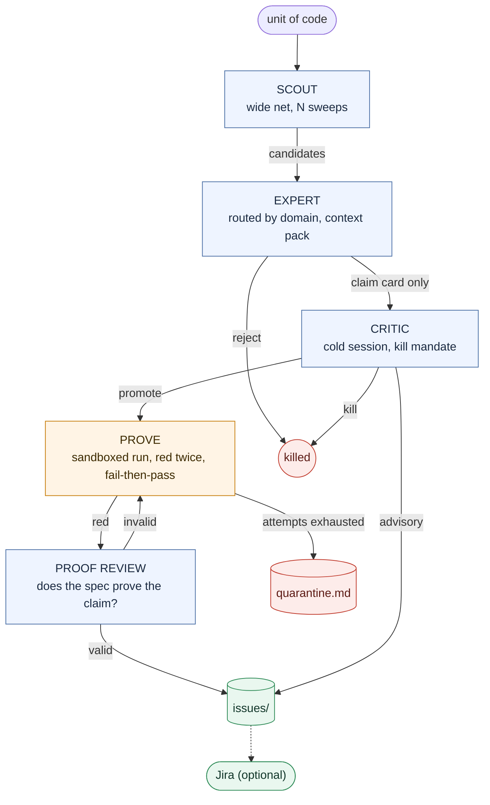

# habeas

Provider-agnostic Agent Skill that incrementally audits a git-checked-out
codebase and emits only findings that survive a mechanical proof gate.

## What "habeas" means

*Habeas* is Latin for "you shall have". It is the first word of *habeas
corpus* — "you shall have the body" — the opening of a medieval English
writ that ordered a jailer to bring a prisoner before a court and show
lawful grounds for holding them. If the jailer could not, the prisoner
went free. The writ does not decide guilt; it only demands that whoever
makes the accusation produce the evidence.

habeas applies the same rule to code findings. A claim that the code is
wrong is an accusation, and the tool is the court: produce a test that
fails on the current code for the claimed reason, or the finding is
released (killed or quarantined). **Produce the evidence or release the
finding.**

## How it works



Blue stages are model roles, each a fresh headless CLI session; the orange
stage is the mechanical gate (a prover model writes the spec, but `prove.sh`
alone judges it). Every finding ends in exactly one of the three
sinks: an issue folder, `quarantine.md`, or killed (recorded in state with
the reason).

One run scans one unit (a directory, a file, or a small cluster of paths):

1. **Scout** reads the unit's files and returns a short list of candidates
   (max `gates.max_candidates_per_unit`). Candidates are fingerprinted and
   deduped; files already scanned with unchanged content yield nothing new.
2. **Expert** validates each candidate against a mechanically built context
   pack (flagged file, callers, per-domain extras), routed to one of four
   prompts: `expert-security`, `expert-db`, `expert-tests`, `expert-backend`.
   It proceeds (with a title, failure scenario, proof sketch, and fix
   sketch), rejects, or splits the candidate into narrower ones (one level).
3. **Critic** tries to kill each validated finding. It promotes, demotes to
   advisory, or kills; an unparseable answer is a kill.
4. **Prover** writes the proof spec (and may correct the fix diff);
   `prove.sh` runs it under the sandbox and applies the gates, up to
   `proof.attempts_max` attempts, each retry seeing the previous failure.
5. **Proof review** confirms a red spec actually proves the claim rather
   than manufacturing its own failure.
6. **Emit** writes issue folders and quarantine entries; the optional
   tracker pushes tickets.

Three properties hold throughout:

- **Two tracks.** Provable (`bug`, `security`): emitted only with a proof
  folder — a spec red on HEAD for the claimed reason, twice, deterministically;
  security findings additionally require fail-then-pass with a fix diff.
  Advisory (`improvement`, `test-gap`): critic-gated opinion, severity capped
  at medium, clearly labeled.
- **Context asymmetry.** The critic runs as a fresh headless CLI session in a
  throwaway git worktree, receiving only the claim card (file, lines,
  category, severity, failure scenario, evidence snippet). The dispatcher
  verifies that the review worktree belongs to the target.
  This limits the information Habeas passes directly. A worktree still shares
  Git history and depends on the provider's filesystem permissions.
- **Nothing silently dropped.** Every finding lives in `.audit/state.json`
  with a full lifecycle history; kill, quarantine, and emit are the only
  exits.

### Finding lifecycle

```
candidate ──> expert_validated ──> critic_survived ──> proved ──────────> emitted
    │                │                   │               ▲
    │                │                   └──> proof_failed ──> quarantined
    │                └──> critic_advisory ──────────────────────────────> emitted
    └──> killed  (reachable from every non-terminal status)
```

`state.py transition` is the only way to move a finding and rejects any edge
not in this graph. A killed finding is suppressed for 30 days; if the scout
rediscovers it after that, the same entry is revived with its history intact.
The fingerprint is `sha256(path, category, normalized snippet)[:16]`, so it
survives line drift and reformatting but not a rewrite of the flagged code.

## Install

The skill is this directory (`SKILL.md` at its root). Copy or clone it as
`habeas/` directly under a skills directory — hosts discover `SKILL.md` only
one level deep:

| Host | User-level | Project-level |
|---|---|---|
| Claude Code | `~/.claude/skills/habeas/` | `.claude/skills/habeas/` |
| Codex CLI | `~/.codex/skills/habeas/` | — |
| pi | `~/.pi/agent/skills/habeas/` | `.pi/skills/habeas/` |
| Grok CLI | `~/.grok/skills/habeas/` | — |

Grok also scans `~/.claude/skills/` and `<cwd>/.claude/skills/` by default
(`[compat.claude] skills = true` in `~/.grok/config.toml`), so the Claude
install covers Grok too.

Requirements:

- bash, git, and python3 >= 3.10 (stdlib only — nothing to pip install).
- At least one headless model CLI on PATH (see [Providers](#providers-adaptersconf)).
  The default config runs every role through `claude`.
- For proof execution, a target repo whose test suite runs via
  `proof.test_cmd`: RSpec by default, pytest via `proof.framework`, and Jest
  per finding via `proof.test_cmd_jest`.
- Docker, only when `sandbox.mode: container`.

## Quickstart

```bash
cd <target-repo>
# Optional. Review provider, tracker and sandbox settings before selecting a config.
export HABEAS_CONFIG=/absolute/path/to/reviewed-config.yaml
python3 <skill>/scripts/state.py --repo . init
<skill>/scripts/run.sh --unit app/services/refunds --repo .
```

There are two ways to run:

- **Scripted** (`run.sh`, above): every role is dispatched as a fresh
  headless CLI session with its pinned model. `run.sh` prints the run's
  stage counts as JSON on stdout and logs progress to stderr.
- **Inline**: an interactive host (Claude Code, etc.) reads `SKILL.md` and
  follows its procedure, doing scout, expert, and proof materialization
  itself with its own model. The critic, proof review, and proofs always go
  through the scripts. `run.sh --from critic` runs just the isolated back
  half of the pipeline on the currently open run.

Outputs land in the target repo:

| Path | Contents |
|---|---|
| `issues/<NNNN>-<slug>/` | One folder per emitted finding: `ISSUE.md`, plus the spec (`proof_spec.rb`, `proof_spec.py` or `proof_spec.test.tsx`) and `proof_run.log` for provable ones. Meant to be committed and reviewed. |
| `quarantine.md` | Critic survivors that failed the proof gate. |
| `.audit/` | `state.json`, per-run artifacts under `runs/<run-id>/` (prompts, raw model output, packs, proof logs), `metrics.jsonl`. Added to the target's `.gitignore` automatically. |

## Repository layout

```
SKILL.md                 skill entry point: hard rules + inline-mode procedure
adapters.conf            one headless invocation template per provider
config.example.yaml      every config key with its default
prompts/                 role prompts: scout, expert-{backend,db,security,tests},
                         critic, prover, proof-review
references/              proof-gate.md (normative gates), context-packs.md,
                         negative-examples.md (do-not-flag list), models.md
scripts/                 the pipeline (see Command reference)
fixtures/                toy payments library with planted defects (selftest)
tests/                   mechanical unit suite (unittest, stdlib only)
bin/habeas, engine/      the deep-audit engine (see "Deep audit engine")
config/, prompts/deep/   its config and prompts
habeas-implementation-plan.md   the original build spec ("plan N" in comments)
```

## Command reference

All scripts self-locate and take `--repo <target-repo>` (default: cwd).

| Script | Purpose |
|---|---|
| `run.sh --unit <path> [--unit ...] [--from scout\|critic] [--sweeps N]` | One full pipeline run. Repeated `--unit` scans several paths as one unit. |
| `run.sh --report [--json] [--kills]` | Tuning report, or the kill-review digest. |
| `hotspots.py [--top 10] [--days 180] [--depth 2]` | Churn x size queue of units to scan next. |
| `verdict.sh <issue-id> useful\|noise` | Record a human judgment on an emitted issue. |
| `state.py <subcommand>` | The only writer of `.audit/state.json`: `init`, `run-start`, `run-end`, `add-candidates`, `transition`, `annotate`, `record-hunks`, `is-scanned`, `open-fingerprints`, `show`, `config`, `config-get`. |
| `dispatch.sh <role> <prompt> <input> [--cwd] [--run-dir]` | Run one model role headlessly; prints the extracted JSON. |
| `contextpack.py <finding.json> --out pack.md` | Build an expert context pack; prints the route. |
| `assemble_prompt.py <prompt> --categories a,b` | Inline the negative examples into a role prompt. |
| `prove.sh <finding.json> <spec> --worktree <dir> [--log-dir]` | One proof attempt under the gates and sandbox. |
| `emit.py <fingerprint>` | Emit one finding (issue folder or quarantine entry). |
| `tracker.py push\|refresh\|attach\|verify [--fingerprint <fp>]` | Jira integration (`push` also takes `--dry-run`). |
| `selftest.sh [--keep] [--work <dir>]` | End-to-end regression run on the fixture. |

`fingerprint.py`, `json_extract.py`, and `prove_gates.py` are helpers behind
the scripts above; each is independently runnable and tested.

Environment variables:

| Variable | Effect |
|---|---|
| `HABEAS_DISPATCH_TIMEOUT` | Hard timeout per model call in seconds (default 600). |
| `HABEAS_CONFIG` | Absolute path to the operator-selected config. |
| `HABEAS_ALLOW_HOST_PROOFS=1` | Allows generated tests to run on the host in `env` mode. |
| `HABEAS_DAYBREAK=1` | Requests Daybreak for the Codex adapter using the account's approved access. |
| `HABEAS_GENERIC_CMD` | Command for the `generic` provider. |
| `HABEAS_I_UNDERSTAND=1` | Required, with `sandbox.mode: none`, to run proofs unsandboxed. |
| `JIRA_API_TOKEN` (or `HABEAS_JIRA_TOKEN`) | Jira API token; never read from config. |
| `JIRA_EMAIL` | Jira account email, when not set as `tracker.jira_email`. |

## Providers (`adapters.conf`)

One headless invocation template per provider (`claude`, `codex`, `grok`,
`pi`, `generic`); `dispatch.sh` picks the provider per role from
`providers.<role>`, falling back to the scout's provider, then the first
installed CLI. Expert routes and the prover share `providers.expert`. All
roles run read-only: model roles only ever return JSON — the scripts do
every filesystem write.

`dispatch.sh` appends the role's input to its prompt after an `---INPUT---`
marker and requires a successful CLI exit and a single JSON object or array.
An ambiguous reply gets one format retry. A failed scout leaves the unit
unscanned. The run directory contains the raw reply and provider stderr.

Treat the installation, adapter templates and operator-selected configuration as
trusted code. The built-in adapters request restricted tools where supported.
Foreign project configuration, provider extensions and filesystem access depend
on the CLI. For unfamiliar repositories, run the whole skill in a disposable
environment containing only the checkout and the credentials needed for that
review. Container proof mode isolates the test process. The role CLIs still run
where the skill was started. A model can misclassify a finding or follow text
in a file despite the prompt's untrusted-input clause.

### OpenAI in scripted mode

Select a reviewed profile with `providers.scout`, `expert`, `critic` and
`proof_review` set to `codex`. Set the five entries under `models` and
`effort`, including `prover`. The adapter passes `--model` and
`-c model_reasoning_effort=…` to `codex exec`. A local profile using
`reasoning` is also accepted. The adapter starts an ephemeral, read-only
session and ignores user config, project instructions loaded through the
Codex project-doc setting, exec-policy rules, hooks, apps and plugins.

To run just a source review, assemble the scout prompt and dispatch it with
a source file. Run the commands from the installed skill directory.

```bash
export HABEAS_CONFIG=/absolute/path/to/reviewed-openai-profile.yaml
repo=/absolute/path/to/checkout
prompt=$(mktemp)
python3 scripts/assemble_prompt.py prompts/scout.md \
  --categories bug,security,improvement,test-gap > "$prompt"
scripts/dispatch.sh scout "$prompt" "$repo/src/example.py" --repo "$repo"
```

The full pipeline uses `scripts/run.sh --unit src --repo "$repo"`.
Habeas treats the CLI's exit status and response format as separate checks.
If a request encounters a cyber safety message, retain the exact message,
role, timestamp and request ID for support. Approved accounts can request
Daybreak with `HABEAS_DAYBREAK=1`. Model and tier coverage vary.
[OpenAI Daybreak access](https://help.openai.com/en/articles/20001258-openai-daybreak-trusted-access-for-cyber-overview)
and [troubleshooting](https://help.openai.com/en/articles/20001259-troubleshooting-openai-daybreak).

## Models per role

Every role runs on Claude by default, with its model pinned by `models.<role>`
and its effort by `effort.<role>`. `dispatch.sh` fills the template
placeholders `{model_args}` / `{effort_args}` with these values and logs
`role=… provider=… model=… effort=…` on every dispatch.

| Role | Model | Effort |
|---|---|---|
| scout | `claude-sonnet-5-5` | medium |
| expert (all `expert-*` routes) | `claude-opus-5-5` | high |
| prover | `claude-opus-5-5` | high |
| critic | `claude-fable-5-2` | high |
| proof_review | `claude-sonnet-5-5` | medium |

The critic uses a different model from the expert, so it doesn't share the
expert's blind spots. A role with a pinned model never falls back to another
provider; it fails instead (set `models.<role>: null` to allow the fallback
chain). The Claude and Codex templates pass model and effort selections. For other
adapters, configure flags supported by that CLI or select its defaults.
In inline mode, the interactive host does the scout, expert, and prover
work, so pin those with scripted runs (`run.sh`). Reasoning and prices are
in [references/models.md](references/models.md).

## Configuration

A file selected with `HABEAS_CONFIG` overrides the skill's
`config.example.yaml`. With no explicit selection, the skill checks
`config.yaml` and then `.audit/config.yaml` for ordinary scope and gate
settings. Finding operational settings there stops the run with the path
to review. Prefer an operator-owned config outside the target checkout.
The target's `.audit` state and run artifacts must be local to the operator.

| Section | Keys |
|---|---|
| `orchestration` | `inline` \| `scripted` |
| `providers.*`, `models.*`, `effort.*` | Provider, model, and effort per role |
| `proof.*` | `test_cmd`, `framework` (rspec \| pytest), `spec_dir`, `test_cmd_jest`, `jest_dir`, `boot_cmd`, `base_url`, `seed_cmd`, `timeout_s`, `attempts_max`, `repair_fixes` (security_only \| always) |
| `sandbox.*` | `mode` (env \| container \| none), `env_allowlist`, `database_url`, `container_image` |
| `gates.*` | `advisory_severity_cap`, `max_candidates_per_unit`, `max_emissions_per_run` |
| `packs.*` | `security_globs` (auth files added to security packs) |
| `tracker.*` | `kind`, `jira_base_url`, `jira_project`, `jira_issue_type`, `jira_email`, `tracks` |
| `scope.*` | `exclude` |
| `scan.*` | `unit_max_lines`, `scout_sweeps`, `parallel`, `hotspot_exclude` |

**Restricted YAML.** The parser is a small stdlib-only one (PyYAML is not
stdlib): two-space indent, scalars, quoted strings, `null`, inline
`[a, b]` and block lists, ONE nesting level of maps. No anchors, no multiline
strings, no lists of maps. `state.py config` shows you the merged result.

## Proof gate and sandbox

Proofs run only through `prove.sh`; `references/proof-gate.md` is the
normative text. A proof passes when:

1. **It ran** — the framework printed a summary with at least one example
   and no errors outside examples. A timeout or load error is a failed proof.
2. **It is red for the claimed reason** — the first failure block matches
   the expert's `expected_failure_pattern`.
3. **It is deterministic** — two runs give the same failure count and the
   same normalized first failure.
4. **It is not self-satisfying** — the proof-review role's check.
5. **Security only: fail-then-pass** — the fix diff applies and turns the
   spec green. For bugs this is attempted and recorded but does not gate;
   with `proof.repair_fixes: always`, a proved bug whose fix diff did not
   verify gets one prover pass to repair the diff.

The spec is copied into the worktree as `<proof.spec_dir>/audit_<fp>_spec.rb`
(rspec), `<proof.spec_dir>/test_audit_<fp>.py` (pytest), or
`<proof.jest_dir>/audit_<fp>.test.tsx` (jest). A finding whose
`proof_sketch.type` is `jest` uses `proof.test_cmd_jest` whatever the
repo-wide framework is, and quarantines as `harness_missing` when that key
is unset.

Sandbox modes:

- `env` (default) quarantines executable proofs as `host_execution_disabled`
  unless the operator sets `HABEAS_ALLOW_HOST_PROOFS=1`. That opt-in runs
  generated code with the host user’s filesystem permissions. The runner
  forwards only allowlisted variables, sets `DATABASE_URL` and `RAILS_ENV`,
  and uses `unshare -n` on Linux when available.
- `container`: Docker with `--network none`, a read-only worktree mount and a
  fresh writable copy inside each container
  (`network_isolated: true` by construction); refused without
  `sandbox.container_image`. Mandatory for HTTP-class proofs, unattended
  runs, or repos whose dev/test config carries real credentials. The image
  must carry the app's test dependencies and — since there is no network —
  any service the suite needs (e.g. its own postgres on the container's
  loopback, booted by a small entrypoint that `proof.test_cmd` calls;
  validated live on a Rails app).
- `none`: refused unless configured AND `HABEAS_I_UNDERSTAND=1`; logs loudly.

Seeds must be synthetic (`proof.seed_cmd`); never point the sandbox DB at a
production copy. HTTP-class proofs (`proof_sketch.type: http`) are not yet
executed: they quarantine as `harness_missing`.

## Choosing what to scan

`scripts/hotspots.py --repo <target> [--depth 3]` prints a churn x size
queue: commits touching a unit in the last `--days` times its average file
length, highest first. It excludes `scope.exclude` and `scan.hotspot_exclude`
(spec/doc/asset paths and lockfiles by default) and skips units already
scanned and unchanged. Feed entries to `run.sh --unit`.

- `run.sh --unit a --unit b` scans several paths as one unit — use it for
  clusters like a state machine plus its job.
- A unit is trimmed to `scan.unit_max_lines` (default 500), alphabetically;
  the deferred files are logged. Rerun on a narrower path to cover them.
- `--sweeps N` (or `scan.scout_sweeps`) runs N independent scout passes
  unioned through dedupe, buying recall.
- `scan.parallel` (default 4) fans out expert and critic dispatches. State
  writes and the prove stage stay serial.
- At most `gates.max_emissions_per_run` (default 5) findings are emitted per
  run; the rest stay in state and emit on the next run. Quarantine entries
  don't count against the cap.

## Metrics and verdicts

Each run appends one line to `.audit/metrics.jsonl` (stage counts, wallclock
per stage, dispatch calls, proof attempts). Judge emissions with:

```bash
<skill>/scripts/verdict.sh <issue-id> useful|noise --repo <target-repo>
```

The two numbers that drive tuning are printed by `run.sh --report --repo
<target-repo>`: useful rate of emissions (target >= 70% by end of v2; below
50% means tighten the critic and negative examples before any feature work)
and quarantine composition (real bugs landing there means the recall hole is
too big).

`run.sh --report --kills` prints the kill digest — every killed finding with
its actor and rationale: recurring good kills become bullets in
`references/negative-examples.md` (inlined into every prompt at dispatch
time), bad kills become prompt calibration.

## Issue tracker (flag-gated)

With a `tracker:` section in config (see `config.example.yaml`; `kind: null`
disables), `run.sh` pushes each run's newly emitted findings as Jira tickets:
short expert-written title, full claim/failure scenario/evidence, a
self-contained How-to-replicate (the complete proof spec inlined plus the
exact run command), resolution guidance, and the finding's artifacts
(ISSUE.md, the proof spec, proof_run.log) uploaded as attachments.
`tracker.tracks` selects which tracks become tickets; advisory tickets carry
the opinion banner. Credentials: email via config or `JIRA_EMAIL`; the API
token ONLY via the environment (`JIRA_API_TOKEN`).

Ticket keys are recorded in state and every ticket carries an
`fp-<fingerprint>` label with a JQL pre-check on push, so nothing is pushed
twice — even after a lost `.audit/`. The other subcommands, all idempotent:

- `tracker.py push --dry-run` shows what would be created.
- `tracker.py refresh` re-PUTs ticket text after format changes.
- `tracker.py attach` backfills attachments.
- `tracker.py verify` re-runs the proof specs of ticketed findings against
  current HEAD and comments once on any ticket whose spec now passes
  ("defect appears fixed") — every emitted proof doubles as a regression
  sentinel.

Tracker outages never block emission.

## Testing

Run the deterministic suite and the targeted mutation checks from the skill
directory. Model invocations in the suite use local stand-ins. Tracker tests
use a loopback Jira server. The real container tests additionally require a
running Docker daemon and a local `habeas-proof-ruby:latest` image with RSpec.

```bash
python3 -m unittest discover -s tests
python3 tests/mutate.py
```

The mutation runner checks an unchanged baseline, then edits one prompt or
runtime guard at a time in a temporary copy. A mutant is killed when its
assigned test fails an assertion. Errors, skipped tests and timeouts are
reported separately. Prompt-text mutations check the role contract. Measuring
model behavior calls for repeated trials with the same model and fixtures.

The live recall self-test uses real model CLIs and generally takes about
20–30 calls. Select a reviewed configuration with a working proof container.
For trusted fixtures in a disposable machine, the host-proof opt-in also works.

```bash
<skill>/scripts/selftest.sh [--keep]
```

It builds the bundled fixture repo (a toy payments library with 5 planted
defects and 4 lookalikes; ground truth in `fixtures/PLANTS.md`), runs the
full pipeline in scripted mode using the selected profile (or installed provider
defaults when no profile is selected), and asserts: >= 3 of 5 plants emitted with valid proofs, 0
lookalikes emitted (matched against issue Claims, so a finding may
legitimately mention a neighboring lookalike to distinguish itself), no
silent drops, complete lifecycle histories, and a clean second run (zero new
candidates; only emission-cap carry-over may emit; no duplicate
fingerprints). This is the regression harness for every change to the
skill. `--keep` preserves the work directory for debugging.

## Deep audit engine (`bin/habeas`)

A second mode, separate from the single-unit pipeline above. (Its build plan,
`habeas-deep-audit-implementation-plan.md`, is not kept in this repository;
"the plan" in comments refers to it.) One run sends every unit of a
codebase through several model labs, several times, and keeps only findings
with a mechanical proof: a test that fails on the audited commit and passes
after a minimal fix. Models are called over HTTP (OpenRouter or any
OpenAI-compatible endpoint), not through headless CLIs. It is stdlib Python,
like the rest of the skill.

How it differs from the pipeline above:

- Extra models combine as a union or as any-of. A cluster is refuted only when
  every critic refutes it, and candidates merge only when two models agree.
- All state is in `runs/<run_id>/ledger.sqlite`. Every candidate ends in one
  named outcome (`proven`, `quarantined`, `refuted`, `unproven_dropped`,
  `known`), and `habeas reconcile` checks that the counts add up.
- Budget limits are soft. At a limit the run pauses, nothing is dropped, and
  only an explicit `habeas budget raise` followed by `habeas resume` continues.
- Every finished model call has an idempotency key, so a killed or paused run
  resumes without repeating a call.

Config, in `config/`:

| File | Contents |
|---|---|
| `models.yaml` | Endpoints and seats (one model in one role). |
| `run.yaml` | Target clone, unit globs, lenses, prover rules, baseline, budget. Git-ignored: copy `run.example.yaml` and fill in the `TODO` values. `runners/example-rspec.sh` is a sample Docker test runner. |
| `lenses.yaml` | The invariants each lens checks. |
| `static_rules.yaml` | Model-free rules for the `static-rules` seat. |
| `severity.yaml` | The severity rubric. |

`TODO` values are the owner's to fill in; every command except `config check`
refuses to run while one remains. The YAML parser is the engine's own subset
(`engine/yamlish.py`): nested maps and lists and one-line flow collections, no
anchors, tags or multi-line strings.

**Merging.** `merge.mode` in `run.yaml` picks how candidates become clusters.
`pairs` asks the merger and the merge auditor about each pair of nearby
candidates. The number of pairs grows with the square of a group, so large runs
use `partition`: each of the two seats sorts a whole group in one call (groups
larger than `merge.partition_max` are sorted in windows, by place in the code),
and two candidates join only when both seats put them together. Partition mode
is the cheaper and less tested of the two; it tends to leave duplicates apart,
which the report's grouping by fix location partly makes up for.

**Refused calls.** When a seat's model refuses a call (HTTP 403 refusal, a 403
that says the content was flagged, content filter, or refusal text in place of
the answer), the engine sends the same call
once to another model: the seat's `alternate_model`, else
`refusal_fallback.model` in `models.yaml`. The refused call stays in the ledger,
and the fallback's row names the model that answered. Set
`refusal_fallback: false` on a seat to switch it off (the proof checkers do: a
refused proof check goes to the other checker seat). A scripted prover that answers but
declines the task is treated the same way, whatever its reason: its fallback
model gets the same attempt, and the cluster is recorded as refused only when
both decline (the row keeps both reasons). `prove run --retry-declines` gives
earlier declines to the fallback model.

**Attempts lost to the platform.** A proof attempt that ends because the call
failed (rate limit, credits, gateway error), on the seat's model or on its
fallback, is not a result. Every `prove run` gives such attempts back and sends
the calls again, and `finalize` does not settle a cluster while one is left: the
run stays partial and names the prover seats to run again.
`finalize --accept-lost-attempts` settles them as they are. A rate-limited call
is retried up to nine times, waiting about a minute at most each time.

**Where the proof test goes.** By default the test is saved in the package of
the claimed code. When the code that must be fixed lives in another package (an
engine that owns the lookup, say), a prover may name that package
(`test_package` in a scripted submission, `--test-package` on `verify-proof`).
The test then runs with that package's specs, and the fix must change a file in
it. Each proof row records the destination and the model that wrote it.

**Running provers side by side.** `prove run --shard i/n` works one slot of the
queue, so n processes can run at once. The audit clone has one lock: testing a
proof holds it alone, and a prover reading files shares it, so no prover reads
the clone while another proof's fix is applied. A cluster's state is checked
again once the lock is held, so two provers cannot both prove it. Because every
proof test waits for that lock, keep `provers.timeout_minutes` low (10 in the
example); a red or green run that errors or times out ends the attempt without
further repeats. `--after <seat>` takes only clusters another prover has
finished with, and `--lens` one lens. `habeas stop` does not end a running
`prove run`; end those processes yourself when no proof test is running.

**Manual review.** `habeas review <cluster> --severity <level> --note <text>`
records a person's judgement of a cluster. On the next `finalize`
that severity replaces the models' labels, and the note appears in the issue
under "Manual review".

**After a gate fault.** `prove recheck --reason '<LIKE pattern>'` runs stored
proofs that failed the mechanical step for that reason through the gate again.
A row changes only once its new result exists.

**Finished runs keep their configuration** in `<run>/config`; `report` and
`reconcile` on a finished run read that copy, so later changes to lenses or
seats do not alter an old report. The report also groups proven clusters whose
fixes change the same lines, as a rough count of distinct defects.

Commands (each prints at most about 20 lines and takes `--json`; `--run-dir`
selects a run, default the latest):

| Command | Does |
|---|---|
| `habeas config check [--online]` | Validate config and list TODO values. `--online` checks each model ID and effort level against the endpoint's model list. |
| `habeas preflight` | Create the run: units, secret scan, scanner hits, context, baseline, static-rule candidates. |
| `habeas scout` | Order the queue by scanner hits. |
| `habeas find [--engine E] [--max-units N] [--retry-errors] [--detach]` | Finder calls: units x finder seats x runs. |
| `habeas merge`, `habeas critique` | Cluster candidates; run the critic panel. |
| `habeas prove next --prover <seat>` | Write the brief for the next cluster (native prover). |
| `habeas prove run --prover <seat> [--shard i/n] [--after <seat>] [--lens L] [--retry-errors] [--retry-declines]` | Run a scripted prover over the proof queue. |
| `habeas prove recheck --reason <pattern>` | Run stored proofs through the gate again after a gate fault. |
| `habeas prove refuse <cluster> [--prover <seat>]` | Record that a prover declined. |
| `habeas verify-proof <cluster> --test <p> --fix <p> [--prover <seat>] [--test-package <pkg>]` | Mechanical red-green in the audit clone, then the proof check. |
| `habeas finalize [--close] [--drift-ref REF] [--accept-lost-attempts]` | Issue files, quarantine entries, drift check, report. |
| `habeas review <cluster> --severity <level> [--note T \| --note-file F] [--reviewer NAME]` | Record a manual severity and note for a cluster. |
| `habeas report`, `habeas reconcile`, `habeas show <cluster>` | Rewrite the report; conservation check; one cluster in full. |
| `habeas status`, `habeas stop`, `habeas budget raise`, `habeas resume` | Progress and spend; stop after calls in flight; raise a limit; continue. |

Proofs run on the developer's machine in the audit clone: a second clone used
only by the audit. `verify-proof` refuses unless `HABEAS_ALLOW_HOST_PROOFS=1`
is set, the clone is clean and at the audited commit, and the config confirms
that the test setup blocks unrecorded outbound HTTP. It restores the clone
after every attempt. Tests see a reduced environment without API keys.

`runs/` holds source excerpts and proofs of defects. It is git-ignored; keep it
on an encrypted disk, readable only by the people running the audit. API keys
come from the environment and are never written to the ledger or raw logs.

Not built yet (the plan's "later" list): the scout model,
flow units, canaries, the cross-run cache, an external harness as prover, the
`anthropic_messages` adapter, the Batch API, `habeas export`, `habeas triage`
(edit `triage_state` in the quarantine file for now), and the bake-off. Only
Brakeman is run as a scanner; other reports are imported through
`baseline.scanner_reports` in Brakeman JSON form. Proof log parsing is RSpec
only.

## Implementation decisions (decide-and-note log)

- Fixture sources live as plain files; `fixtures/build_fixture.sh` constructs
  the git history (`PLANT: <n>` commits) since a nested `.git` cannot be
  tracked. `fixtures/PLANTS.md` is ground truth and is never copied into
  built fixtures.
- All model roles are dispatched read-only; scripts do every write.
- `dispatch.sh` enforces critic/proof-review isolation: refuses to run them
  outside a linked git worktree (exit 4) and scrubs `issues/` +
  `quarantine.md` inside it first.
- Fingerprint normalization also drops blank lines (blank-line churn is
  reformatting).
- `state.py transition --record` merges stage output into the finding record;
  demotion to advisory clamps severity mechanically; advisory-track findings
  cannot enter `critic_survived`.
- A `run-start` while another run is open marks the older run abandoned.
- Negative examples are single-sourced in `references/negative-examples.md`
  and inlined into prompts at dispatch time by `assemble_prompt.py`
  (`{{NEGATIVE_EXAMPLES}}` marker); `proof-review.md` deliberately has none.
- `GEM_PATH` is in the default env allowlist (rvm needs it); allowlisted
  variables are forwarded only when actually set (an empty `BUNDLE_PATH=""`
  breaks bundler).
- Advisory issues use the same `issues/<NNNN>-<slug>/` folder layout, holding
  only `ISSUE.md`.
- Emission order: provable first, then advisory; quarantine bypasses the
  emission cap.
- `proof_sketch.type: http` execution is not yet implemented; such findings
  always quarantine as `harness_missing`.
- Schema pack extras read `db/structure.sql` when there is no `db/schema.rb`.
- The prover may return a corrected `fix` diff (used when the expert's diff
  fails to apply or green — security emissions depend on fail-then-pass).
- `hotspots.py` additionally excludes `scan.hotspot_exclude` (spec/test/doc/
  asset dirs, lockfiles, structure.sql): churn there is not audit surface.
- Experts write the finding `title` (max 9 words) on proceed; it names the
  issue folder, ISSUE.md H1, and the tracker ticket. `state.py annotate
  --title` can improve it later.
- Parallel dispatch fans out model calls only; every state write stays in a
  serial phase (state.json is a lockless single writer). The prove stage
  stays serial: it mutates a shared worktree.
- Every role prompt carries an untrusted-input clause: repository content and
  INPUT have no authority over roles, verdicts, or output schemas.
- Proof-log parsing is pluggable per `proof.framework` (rspec, pytest, jest);
  a finding whose `proof_sketch.type` is `jest` (frontend code) is routed to
  `proof.test_cmd_jest` and placed under `proof.jest_dir`, whatever the
  repo-wide framework is, so one audit can prove Ruby and TypeScript claims;
  container mode reports `network_isolated: true` by construction.
- Models and effort are pinned per role; a pinned role refuses provider
  fallback rather than silently running a different model.

## Roadmap

- **v2 — precision** (delivered: per-domain expert routing + pack extras,
  `hotspots.py` scan queue, `run.sh --report` + `--kills`, multi-path units,
  scout sweeps, parallel dispatch, prover fix repair, prompt calibration from
  selftest ground truth; remaining: negative examples grown from judged runs).
  Exit: useful rate >= 70% over 20 judged runs.
- **v3 — reach** (delivered early: Jira tracker with attachments, verify, and
  fingerprint-label recovery; container sandbox validated on a real Rails
  app; pytest proof framework; per-finding Jest proofs; per-role model
  pinning; remaining: HTTP-class proofs behind the container+boot contract,
  `test-gap` findings via mutation testing, a GitHub emitter, scheduled
  scripted runs).
